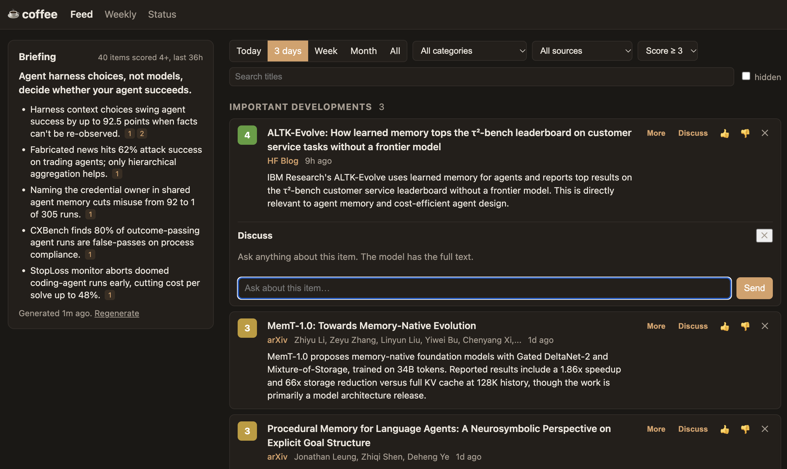

# coffee

A personal, navigable viewer for news, papers and tool releases in the agentic AI
space. It pulls a fixed set of high-signal sources into a local SQLite database,
has Claude score and summarize each item against `profile.md`, and shows the
result in a small local web app.



## Run it

```bash
cp .env.example .env          # add your ANTHROPIC_API_KEY
./coffee.sh                   # starts http://127.0.0.1:8765 and opens your browser
```

On launch, if the last refresh is more than 6 hours old, a refresh runs in the
background while the page loads from existing data. The Status page has a
Refresh button and shows per-source counts.

Without an API key everything still works except scoring: items are collected
and shown under "Not yet scored".

Running `coffee` while an earlier one is still serving on the same port stops
the old server and starts fresh, so you never have to hunt for the old
terminal. If the port is held by something that is not coffee, it says so and
exits; use `PORT=8766 coffee` to pick another.

## Other commands

```bash
.venv/bin/coffee collect      # fetch sources, store new items
.venv/bin/coffee process      # score unprocessed items with Claude
.venv/bin/coffee refresh      # both
.venv/bin/coffee serve --no-refresh --port 9000
.venv/bin/pytest
```

## Sources

- Practitioners and aggregators: Simon Willison, Latent Space, Hacker News (hnrss
  keyword search, 50+ points)
- Labs: OpenAI, Google DeepMind, Google AI, Qwen, Hugging Face blog
- Newsletters: Import AI, Interconnects, Ahead of AI, AI News (smol.ai)
- Blogs: Eugene Yan, Hamel Husain, Lilian Weng
- GitHub releases for LangGraph, OpenAI Agents SDK, Claude Code, DSPy, MCP, Arize Phoenix
- arXiv keyword search over cs.AI, cs.LG, cs.CL, cs.MA
- Hugging Face daily papers

Items older than 14 days are skipped at collect time, since several feeds carry
their full archive. Anthropic and The Batch have no RSS feed and are not
included directly; Anthropic news arrives through the sources above. Edit `coffee/config.py` to add
feeds, repos, or arXiv terms. Edit `profile.md` to change what counts as relevant.

## How it works

```
sources/*  -> collect.py -> SQLite <- web/app.py (FastAPI + HTMX)
                              ^
                process.py (Claude, batched, structured output)
```

Items are deduplicated by normalized URL and by title within 14 days, so an HN
post linking to a blog entry already stored is dropped. Scoring uses
`claude-haiku-5-5` by default (`COFFEE_MODEL` overrides it), in batches of 10,
with the rubric cached and your profile appended. Categories: important
developments, new tools, research, production lessons, noise. Scores run 1 to 5.

The left sidebar on the feed page holds a **briefing**: a short generated summary
of the headlines among items scored 4 or higher that were published or first
seen in the last 36 hours (the window is wide enough to catch arXiv's once-a-day
batch). Each bullet links to the items it draws on. It is generated once per set
of qualifying items and cached, so it only costs a call when something new
arrives; Regenerate forces a fresh one. If fewer than three items reach 4, the
threshold drops to 3. Knobs: `BRIEFING_HOURS`, `BRIEFING_MIN_SCORE`,
`BRIEFING_MAX_ITEMS` in `coffee/config.py`.

Each item has two buttons on the right:

- **More** fetches the item's own page (for papers, the arXiv HTML full text when
  it exists), stores the text and every link it finds, and asks Claude for a
  longer summary plus the primary-source links worth following. Only URLs that
  actually appear in the item can be returned. Generated once, then cached.
- **Discuss** opens a chat box under the item. The full item text is sent as a
  cached system prompt, so follow-up turns are cheap. History persists per item
  until you press Clear.

Both use `claude-sonnet-5-5` by default (`COFFEE_DETAIL_MODEL` overrides it):
they are low-volume calls where quality matters more than the scoring pass.

Thumbs up/down ratings are stored but not yet used; they are the training data
for a later ranking pass.

## Layout

```
coffee.sh            launcher
profile.md           your interests, fed to the model
coffee/config.py     sources, model, paths
coffee/sources/      rss (incl. GitHub releases), arxiv, hf_papers
coffee/collect.py    fetch + dedupe + insert
coffee/process.py    LLM scoring
coffee/fulltext.py   fetch an item's page, extract text and links
coffee/detail.py     long summary and per-item chat
coffee/briefing.py   daily briefing for the sidebar
coffee/refresh.py    collect + process with a lock, background-safe
coffee/web/          FastAPI app, Jinja templates, CSS
tests/               offline tests with saved fixtures
data/coffee.db       created on first run
```
